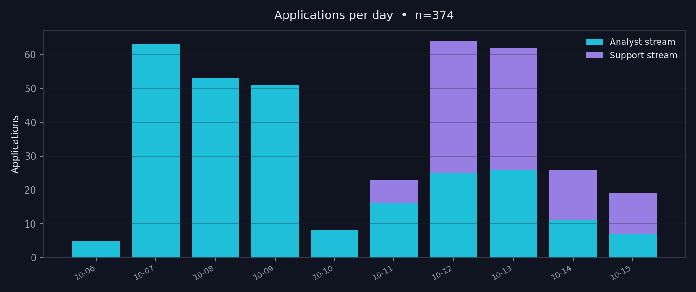
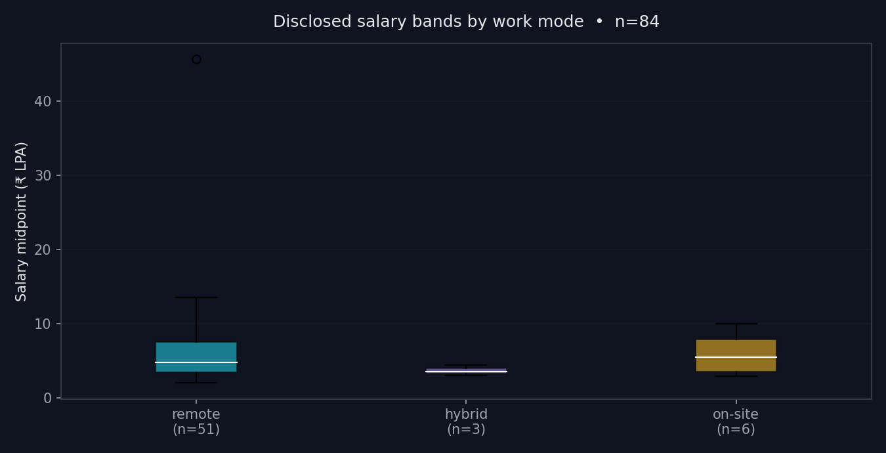
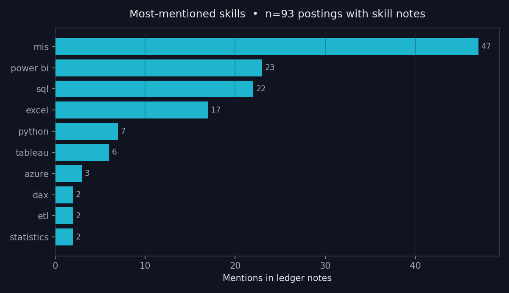

# Data Job-Market Dashboard — what 520 real job applications taught me

**The interactive web dashboard (`dashboard.html`) is the centerpiece of this project** —
open it in any browser (double-click, no server needed) or host it on GitHub Pages.
It is fully self-contained: Plotly is bundled inline, the data is embedded as JSON,
and it makes zero external network requests.

> I analyzed **520 real job postings from my own job search** (6–15 October 2026):
> 403 Data/BI/MIS applications plus 117 remote non-voice support & writing applications,
> logged posting-by-posting in a structured ledger across LinkedIn, Naukri, Instahyre,
> Shine, Internshala, Foundit, email/direct applications, and a Rohtak desk-job round.





## Key findings

1. **Volume wins attention, targeting wins interviews.** 520 applications in 10 days —
   403 analyst + 117 support — peaking at **64 in a single day (12 Oct)**. *(n=520 ledger entries)*
2. **The junior data market is overwhelmingly remote.** **81.7% of postings** with a stated
   work mode were remote; hybrid was rare (7%). *(n=284 known modes; 45% of postings don't state one)*
3. **Disclosed pay centres near my target.** Median disclosed band midpoint is **₹4.5 LPA**
   (IQR ₹3.5–₹6.7) — inside my ₹3–12 LPA analyst band. Analyst-stream median (₹5.25 LPA)
   sits well above support-stream median (₹3.5 LPA). *(n=84 disclosing postings)*
4. **Remote postings disclose slightly lower bands** — median ₹4.75 LPA remote vs ₹5.45 LPA
   on-site — but the on-site sample is tiny, so I read this as **suggestive, not proof**.
   *(remote n=51 · on-site n=6 · hybrid n=3)*
5. **MIS is the most-mentioned skill, then Power BI and SQL.** MIS (47), Power BI (23),
   SQL (22), Excel (17) lead; Python (7) and Tableau (6) trail — matching a market that hires
   **report-builders first, modellers second** at the junior level.
   *(n=93 posting notes with skill info; notes undercount full JDs)*
6. **Employers cluster.** crewlia (33), HRM Counsel (20) and Jobgether (8) dominate —
   aggregators and high-volume hirers, not Big Tech. **45% of postings ask for 0 years
   experience** (106 of 235 with a stated band); none asked for 6+. *(n=235)*

## Methodology

- **Source:** my own verified application ledger — free-text entries in varying formats
  (URLs, titles, companies, locations, salaries like "3-5 LPA", "₹10.7–15 LPA", "$42,000–$68,000",
  experience like "0-2 yrs", work modes). No scraped or third-party data.
- **Parsing** (`analysis/01_parse_ledger.py`): regex/heuristic extraction of title, company,
  portal, city, work mode, salary band (normalised to ₹ LPA; USD-annual ×₹83, monthly ×12),
  experience band, application date, stream, and skill keywords. My own screening answers
  (e.g. "3 LPA current") are stripped before parsing, so bands are the postings'
  requirements, never my responses.
- **Honest coverage:** company 85%, title 85%, city 85%, work mode 55%, salary 16%,
  experience 45%, date 72%, skill keywords 18%. Unparseable entries are marked unknown
  and excluded from the relevant chart — every chart labels its own *n*.
- **Caveats:** salaries are thin (16% disclose) and skew toward staffing firms/startups;
  hourly contract rates ($/hr) are excluded from LPA charts; skill counts come from my
  logging notes, not full job descriptions — directional, not exhaustive.

## How to run

```bash
cd job-market-dashboard
pip install -r analysis/requirements.txt

# 1. parse the raw ledger -> data/postings_clean.csv
python analysis/01_parse_ledger.py

# 2. run the EDA -> analysis/findings.json + PNG previews in assets/
python analysis/02_eda.py

# 3. build the self-contained dashboard
python analysis/03_build_dashboard.py

# 4. open dashboard.html in a browser (double-click works; no server needed)
```

## Tech stack

Python (pandas, matplotlib, numpy) for parsing and analysis · Plotly.js (offline bundle,
inlined) for the interactive dashboard · vanilla HTML/CSS/JS, dark theme, no build step.

## Project layout

```
job-market-dashboard/
├── dashboard.html          # the centerpiece — self-contained interactive dashboard
├── README.md
├── data/
│   ├── postings_clean.csv  # 520 parsed postings
│   └── README.md           # column docs + parse-coverage table
├── analysis/
│   ├── 01_parse_ledger.py  # raw ledger JSON -> clean CSV
│   ├── 02_eda.py           # analysis -> findings.json + PNG previews
│   ├── 03_build_dashboard.py  # findings + Plotly -> dashboard.html
│   ├── findings.json       # every aggregated series the dashboard uses
│   ├── requirements.txt
│   └── vendor/plotly.min.js  # offline Plotly bundle (inlined at build)
└── assets/
    ├── chart_trend.png
    ├── chart_salary_by_mode.png
    └── chart_skills.png
```

*Built by Sudhanshu Dhankhar · MBA Business Analytics · SQL · Python · Power BI —
October 2026. Every number traces to the data; thin samples are labelled, unknowns are
shown, nothing is invented.*
